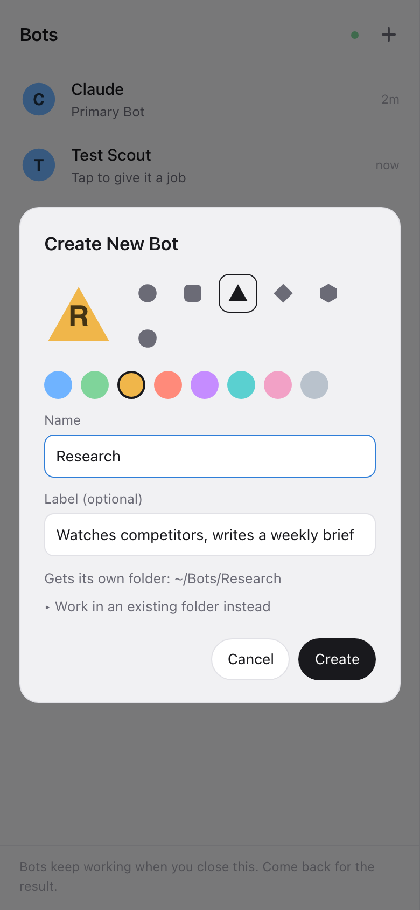
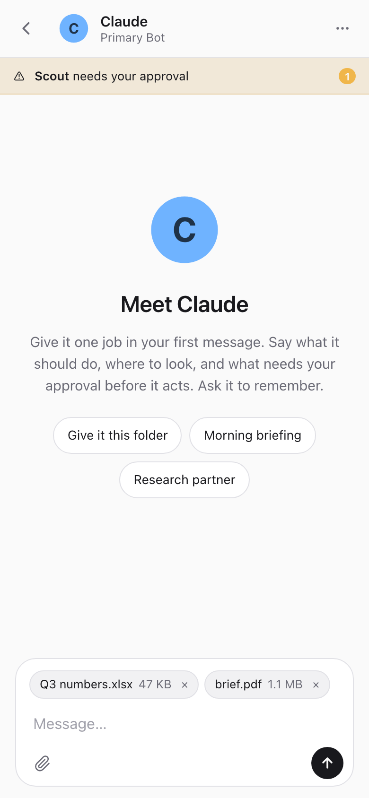
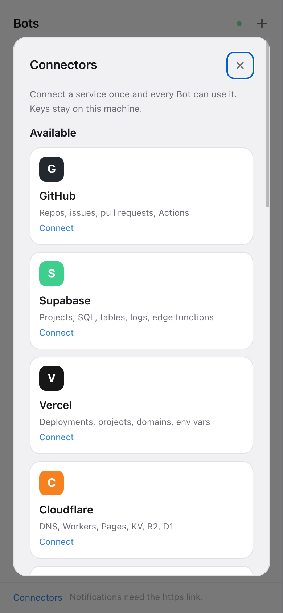

# Code Crew

Grok Bot-style agents on your own Claude subscription. Each **Bot** is a persistent teammate with one job, its own
folder, conversation, memory and routines. Bots run on your machine through [Claude Code](https://docs.anthropic.com/en/docs/claude-code),
keep working when you close the app, hand work to each other, ask you for approvals, and show you what they made.
Built for the phone as much as the desktop.

<p align="center">
  
  
  
</p>

## What you get

- **Bots, not chats.** Name, avatar, folder, model, approval level. The first message gives a Bot its job; it keeps that conversation forever and writes its own memory file.
- **They keep working.** Close the app; come back to an unread dot, a result, or an approval waiting.
- **Routines.** "Every weekday at 09:00", "every hour", "every 20 minutes". Run now, pause, delete.
- **Bots talk to each other.** `@Scout` in a message brings Scout in. Bots message each other by name; tap a "From Scout" card to open that conversation.
- **Approvals as cards**, with "Always allow". New Bots ask before shell commands; set "Never ask" per Bot if you trust it. Unattended requests expire after 30 minutes.
- **Connectors.** GitHub, Supabase, Vercel, Cloudflare, Stripe, Notion, Linear, Slack, Klaviyo, Shopify, Resend, Firecrawl, Context7, a headless Browser, or any MCP server / REST API. Paste a key once; every Bot can use it.
- **Vault.** Bots request logins with a reason; you approve each one. Optional 1Password integration.
- **Media and files.** Images, video, audio and PDFs a Bot produces show inline. Attach files by drag and drop, paste or the paperclip.
- **Phone notifications** for approvals and finished work (https needed, see below).

## Install

Requirements: Node 20+, [Claude Code](https://docs.anthropic.com/en/docs/claude-code) installed and logged in with
your Claude subscription (`claude` once, then `/login`).

```bash
git clone https://github.com/nicope/code-crew && cd code-crew
npm install
npm run setup        # Claude login check, access token, address (Tailscale detected), service install
```

Setup prints a link and a QR code. Open it on your phone, then Share → Add to Home Screen.

Without the wizard: `npm start` serves `http://localhost:4747`. Config lives in `~/.code-crew/config.json`;
every key can be overridden by an environment variable (`CODE_CREW_HOST`, `CODE_CREW_PORT`, `CODE_CREW_TOKEN`,
`CODE_CREW_CWD`, `CODE_CREW_PERMISSION`, `CODE_CREW_MODEL`, `CODE_CREW_BOTS_DIR`, `CODE_CREW_DATA`).

### Your subscription, your machine

Code Crew runs the Claude Code engine with *your* login, so Bots use your Claude plan, not API credits. Anthropic
allows this for your own individual use of Claude Code and the Agent SDK. Do not run one Code Crew for several
people on one subscription, and never set `ANTHROPIC_API_KEY` in its environment (Code Crew strips it so you are
not billed by surprise). Bots running around the clock count against the same usage limits as the terminal.

### Running as a service

The wizard installs a launchd agent (macOS) or a systemd user unit (Linux). On macOS a background process cannot
read the Keychain where `claude login` stores credentials, so the wizard asks for a token from `claude setup-token`
and keeps it in `~/.code-crew/oauth-token` (mode 600). `code-crew service restart|status|uninstall` manage it.

### Phone access and https

Pick the Tailscale address in setup and the link works from any device on your tailnet. For https, which also
unlocks push notifications:

```bash
tailscale serve --bg --https=443 http://<tailscale-ip>:4747
```

On a VPS use the `Dockerfile` (pass `CODE_CREW_TOKEN` and `CLAUDE_CODE_OAUTH_TOKEN`) behind Tailscale or an https
reverse proxy. Never expose the plain http port to the internet: whoever has the token controls the machine.

## How it works

One Node process. The Claude Agent SDK runs a Claude Code session per Bot (resumed across restarts). Bot-to-Bot
messaging, the vault and REST connectors are in-process MCP servers; catalog connectors are official MCP servers
or a request tool over the service's API. State is JSON in `~/.code-crew`. The UI is plain HTML, CSS and JS over a
WebSocket. See [SECURITY.md](SECURITY.md) before exposing it and [CONTRIBUTING.md](CONTRIBUTING.md) to help.

## License

MIT. Code Crew is an independent project, not affiliated with Anthropic or xAI.
